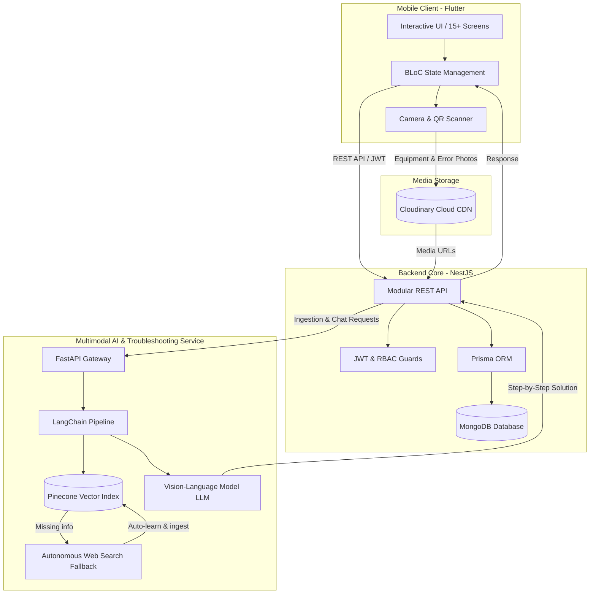

# Chronos — Smart Campus Equipment Sharing & Multimodal AI Troubleshooting Platform

<p align="center">
  <strong>An end-to-end smart campus ecosystem automating laboratory equipment lending, visual inspection, and 24/7 multimodal AI troubleshooting with continuous self-learning.</strong>
</p>

<p align="center">
  <a href="https://flutter.dev"></a>
  <a href="https://dart.dev"></a>
  <a href="https://nestjs.com"></a>
  <a href="https://www.typescriptlang.org"></a>
  <a href="https://fastapi.tiangolo.com"></a>
  <a href="https://www.langchain.com"></a>
  <a href="https://www.pinecone.io"></a>
  <a href="https://www.mongodb.com"></a>
  <a href="https://www.prisma.io"></a>
  <a href="https://cloudinary.com"></a>
</p>

---

## 🏛️ Context & Engineering Internship

**Chronos** was conceptualized and engineered during an international **AIESEC Global Talent** Software Engineering Internship at **Maharishi Markandeshwar University (MMDU)** in Mullana, Haryana, India.

University campuses lend thousands of critical assets (VR headsets, microcontrollers, high-end laptops, robotics kits, and laboratory instruments) to students every semester. Traditional manual workflows lead to tracking bottlenecks, untraced physical defects, and lack of real-time technical support when hardware errors occur.

Chronos solves this through an autonomous 3-module ecosystem. As the **Lead Engineer of Module 3 (Interactive Client & AI Gateway)**, I architected and developed the entire cross-platform mobile client, the centralized API microservices, the vector ingestion pipeline, and the multimodal troubleshooting assistant.

---

## 🌿 Repository Architecture & Branches

To maintain modularity and clean separation of concerns, the project codebase is organized into dedicated branches:

| Branch | Description | Tech Stack |
| :--- | :--- | :--- |
| [**`frontend`**](https://github.com/negzaoui16/Project-Chronos/tree/frontend) | Production Flutter mobile application (15+ screens, BLoC pattern, QR scanning, camera capture) | Flutter, Dart, BLoC, Camera, QR Scanner |
| [**`backend`**](https://github.com/negzaoui16/Project-Chronos/tree/backend) | Scalable backend API microservice, Prisma schema, and Multimodal RAG troubleshooting engine | NestJS, TypeScript, Prisma ORM, MongoDB, FastAPI, LangChain, Pinecone |
| [**`main`**](https://github.com/negzaoui16/Project-Chronos) | System architecture documentation, project specifications, and deployment guide | Markdown, Mermaid Diagrams |

---

## 🧠 System Architecture

The following diagram illustrates the complete end-to-end data flow between the Flutter client, the NestJS gateway, Cloudinary, and the Multimodal RAG troubleshooting engine:



---

## ✨ Key Features

### 1. 📱 Interactive Equipment Marketplace & Slot Reservation
- Real-time catalog of campus hardware with dynamic availability statuses.
- Calendar-based booking engine preventing scheduling conflicts.
- Equipment restitution workflow with QR code verification.

### 2. 🤖 Multimodal RAG Troubleshooting Assistant
- **Multimodal Inputs:** Accepts text queries, photos of hardware error codes, or combined queries.
- **Knowledge Ingestion:** Ingests official MMDU equipment user manuals (PDFs), chunked and embedded via LangChain into Pinecone.
- **Autonomous Web Search Fallback:** If a manual does not contain the answer, the agent autonomously retrieves verified repair documentation from the web.
- **Continuous Self-Learning:** Web-discovered solutions are immediately vector-embedded and indexed into Pinecone for future instant retrieval.

### 3. 🔐 Security, Identity & Data Integrity
- Role-Based Access Control (**RBAC**) separating student privileges from lab administrators.
- Argon2 password hashing and secure stateless JWT bearer token authentication.
- Strict schema validation via **Prisma ORM** over **MongoDB**.

### 4. 🔗 Web3 Escrow Integration
- Transparent tracking of Chronos escrow deposits and smart contract interactions for physical asset guarantees.

---

## 🛠️ Technology Stack

| Layer | Technologies |
| :--- | :--- |
| **Mobile Client** | Flutter 3.x, Dart 3.x, BLoC Pattern, Flutter Secure Storage, Dio, QR Code Scanner |
| **Backend API** | NestJS, TypeScript, Prisma ORM, MongoDB, Passport.js, JWT, Class-Validator |
| **Applied AI & RAG** | Python 3.10+, FastAPI, LangChain, Pinecone Vector DB, HuggingFace, Vision-Language Models |
| **Cloud & DevOps** | Cloudinary (Image CDN), Docker, Git |

---

## 🚀 Quickstart Guide

### 1. Run the Backend API
```bash
git clone -b backend https://github.com/negzaoui16/Project-Chronos.git
cd Project-Chronos
npm install
cp .env.example .env
# Fill in your MongoDB, Cloudinary, and Pinecone credentials in .env
npx prisma generate
npm run start:dev
```

### 2. Run the Flutter Mobile Application
```bash
git clone -b frontend https://github.com/negzaoui16/Project-Chronos.git
cd Project-Chronos
flutter pub get
flutter run
```

---

## 👨‍💻 Author

**Oussama Negzaoui**  
Software & Mobile Engineering Student at **ESPRIT** (Option Mobile) | Graduate from **ISAMM**  
- 💼 **LinkedIn:** [linkedin.com/in/oussama-negzaoui](https://www.linkedin.com/in/oussama-negzaoui-6632431bb/)  
- 🐙 **GitHub:** [@negzaoui16](https://github.com/negzaoui16)  
- 📧 **Email:** negzaouioussama15@gmail.com

---

## 📄 License
This project is licensed under the [MIT License](LICENSE).
